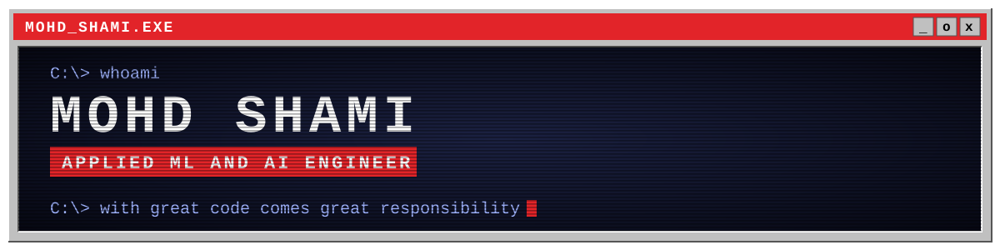

 

Building machine learning systems that are accurate, explainable, and ready for production.

 

---

## About

I turn algorithms into dependable products. My work spans the full machine learning lifecycle: data preprocessing, model design, leakage-free evaluation, low-latency API engineering, and containerized deployment.

The problems I take on are real-world ones: coordinating LLM agents for enterprise workflows, assessing clinical risk from multimodal data, diagnosing crop disease for smallholder farmers, and modeling economic signals across 643 Indian districts.

| | |
| :--- | :--- |
| **Focus** | Agentic AI, computer vision, applied ML, MLOps |
| **Approach** | Evaluate rigorously, explain predictions, ship as services |
| **Practice** | 850+ data structure and algorithm problems solved |
| **Open to** | Applied ML and AI engineering roles, collaborations |

---

## Capabilities

| Area | What I work on |
| :--- | :--- |
| **Agentic AI and LLMs** | Multi-agent orchestration, tool routing, PEFT (LoRA, QLoRA), high-throughput inference, production RAG with vLLM, Qdrant, and FAISS |
| **Deep Learning and Vision** | CNN and vision transformer models, image pathology and segmentation, real-time landmark detection, multimodal diagnostics |
| **Applied ML and Econometrics** | Classification, survival analysis, panel data modeling, forecasting, anomaly detection, explainability with SHAP and LIME |
| **Production Engineering** | FastAPI and Flask services, asynchronous REST APIs, Docker, reproducible pipelines, MLflow and Weights & Biases tracking |

---

## Tech Stack

---

## Engineering Principles

1. **Evaluate honestly.** No test leakage. Choose metrics that match the problem (ROC-AUC, Precision@K, F1), not vanity accuracy.
2. **Build for production, not the notebook.** Clean REST APIs, Pydantic schema validation, Docker, and drift monitoring.
3. **No black boxes.** Pair complex models with SHAP or LIME so stakeholders can see why a prediction was made.
4. **Keep it lean.** Tight inference budgets, vectorized computation, and maintainable architecture over fragile complexity.

---

## GitHub Activity

  
  

---

## Get in Touch

Discussing applied ML, agentic systems, or production AI? I would like to hear from you.

[codexshami@gmail.com](mailto:codexshami@gmail.com) &nbsp;|&nbsp; [LinkedIn](https://linkedin.com/u/mohdshamii) &nbsp;|&nbsp; [Portfolio](https://mohdshamii.github.io)

