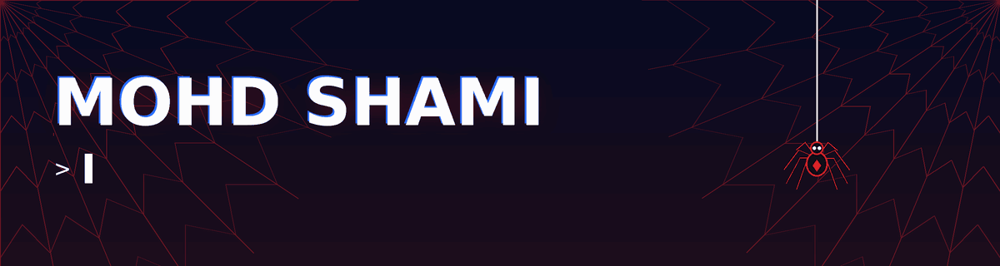
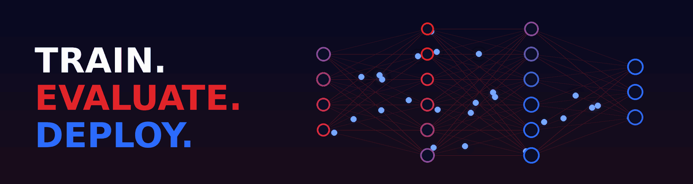
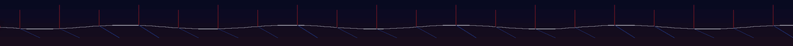

**Building reliable, end-to-end machine learning systems, from data to deployment.**

## About

I turn models into dependable products. My work covers the full lifecycle: data preparation, modeling, rigorous evaluation, API design, testing, and deployment. I care about measurable results, reproducibility, and systems that hold up outside a notebook.

## Focus Areas

- **Applied Machine Learning:** Classification, risk modeling, and predictive systems across healthcare, agriculture, and business analytics.
- **Deep Learning:** Convolutional networks for computer vision, transformer architectures, and representation learning.
- **ML Engineering:** REST API design, automated testing, experiment tracking, and containerized deployment.
- **LLM Systems (growing focus):** Fine-tuning with PEFT/LoRA, retrieval-augmented generation, and efficient inference.

## Technical Toolchain

| Domain | Stack |
| :--- | :--- |
| **Languages** | Python · SQL · Bash · C++ |
| **Modeling** | scikit-learn · TensorFlow / Keras · PyTorch · Hugging Face |
| **Data** | NumPy · Pandas · Polars |
| **Serving & Deployment** | Flask · FastAPI · Docker · REST APIs |
| **Tracking & Tooling** | MLflow · Weights & Biases · Git · Jupyter |
| **Exploring** | vLLM · Qdrant · FAISS · ONNX |

## Engineering Principles

- **Evaluate honestly.** Choose metrics that fit the problem and test for leakage and class imbalance.
- **Build for production.** Version, test, and document what you ship.
- **Keep it simple.** Prefer clear, maintainable solutions over unnecessary complexity.

## GitHub Stats

  
  

## Get in Touch

Open to collaboration, opportunities, and conversations about applied ML.

📧 [codexshami@gmail.com](mailto:codexshami@gmail.com) · 💼 [LinkedIn](https://linkedin.com/in/mohdshamii) · 🌐 [Portfolio](https://mohdshamii.github.io)

